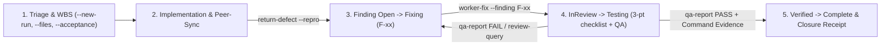

# Team Orchestration Director (ThinkTank v3)

**Case Ledger multi-agent runtime, enforcement backend, and live sidecar UI for Antigravity.**

ThinkTank replaces unverified free-form agent chatter with a stateful **Case Ledger** backed by SQLite, FastAPI, and WebSockets. Every engineering or planning session runs under a fixed **7+1 role hierarchy**, **single-owner WBS file locks**, **HTTP 409 state-machine gates**, **real child-subagent session routing**, **evidence-required QA verification**, and **isolated per-run archival (`--new-run`)** inside a responsive bilingual (**English LTR / Persian RTL**) sidecar pane.

---

## Core Architecture



### What ThinkTank Enforces in Runtime

- **Multi-Run Isolation (`--new-run`):** Running `set-task --new-run` (or starting new work after a closed run) deep-copies and archives the previous ledger as `convId--run-1`, `convId--run-2`, and so on (`isArchivedRun`, `runIndex`), preventing findings, messages, or file locks from bleeding across runs in the same conversation.
- **Real Subagent Activation & Telemetry Routing (`subagent_session_map`):** `tools/thinktank_antigravity_hook.py` correlates `invoke_subagent` and `send_message` tool traffic to map child conversation UUIDs (`subagentConvId`) back to canonical roles (`tt-backend-auditor` -> `backend-auditor`). Active subagents show `verifiedSubagent: true`, child `active-session` callbacks never hijack the parent conversation, and child tool events route onto the parent ledger under the worker's own role.
- **First-Class Finding Lifecycle (`F-01`..):** Findings raised by `council-critic` require concrete severity (`CRITICAL`, `HIGH`, `MEDIUM`, capped at 7 per round) and reproduction steps (`--repro`), progressing through `Open` -> `Fixing` -> `InReview` -> `Testing` -> `Verified` -> `Closed` (or `WontFix` with a non-empty justification via `POST /api/findings/action`).
- **Evidence-Gated QA (`HTTP 409` on Unverified PASS):** `qa-report --finding F-xx --status PASS` is rejected with `HTTP 409` unless accompanied by a non-empty `--cmd`, `--exit-code 0`, trimmed output excerpt, and explicit execution environment (`--runner substrate|host-fallback` plus `--runner-reason`).
- **Honest Origin Provenance:** Every interaction and message carries `origin` (`subagent` from a mapped child session, `main-proxy` logged on behalf of the coordinator, or `user`), summarized as `originCounts` and `qaAllExitZero` in the final `closureReceipt`.
- **Single-Owner File Locks (`File Locks`):** Assigning an active file path simultaneously to two workers in `subtasks/upsert` fails with `HTTP 409` until ownership releases.
- **Hard Closure Gate (`complete`):** Closing a run is blocked (`HTTP 409`) while any finding remains `Open`, `Fixing`, `InReview`, or `Testing` unless explicitly overridden with `--force --reason`. Once closed, the Flow view freezes into a read-only Closure Receipt.

---

## Canonical 7+1 Team & Geometric Taxonomy

Role badges use geometric SVG monograms (`shape = authority tier`) with zero Unicode emojis:

| Tier | Frame | Monogram | Role ID | Responsibility & Gate Authority |
| :--- | :--- | :--- | :--- | :--- |
| Coordinator | Hexagon | `MA` | `main_agent` | Initial scope triage (`thinktank` vs `solo`), user escalation, final handoff |
| Supervisor | Square | `TM` | `team-manager` | WBS decomposition (`--files`, `--acceptance`), progress interrogation |
| Supervisor | Square | `CC` | `council-critic` | Red-team audit under fixed Severity Rubric, diff-scoped findings with `--repro` |
| Supervisor | Square | `CR` | `code-reviewer` | 3-point finding checklist (root cause, callers/tests, minimal diff); commands QA |
| Subordinate QA | Diamond | `QA` | `qa-reviewer` | Executes tests under `code-reviewer`; logs command, exit code, runner & output |
| Worker | Circle | `UI` | `ui-frontend-designer` | Case Ledger UI/UX, `@container` layout, WCAG AA contrast, zero AI slop |
| Worker | Circle | `BE` | `backend-auditor` | FastAPI state machine, SQLite store, WebSocket sync, 409 gates & security |
| Worker | Circle | `SE` | `ecommerce_seo_operator` | Technical SEO, JSON-LD structured data, high-CTR e-commerce copy |
| Worker | Circle | `WP` | `wp_technical_operator` | WordPress & WooCommerce SRE, database/Redis tuning, catalog integrity |

---

## Sidecar UI Architecture (`sidecars/think-tank/`)

The sidecar is built with container queries (`@container` from `360px` compact panes to `1024px+` split views), semantic status tokens (`--paper`, `--sheet`, `--ink`, `--open`, `--working`, `--review`, `--verified`), programmatic WCAG AA contrast parity across dark and light themes, and zero gradients or `transition: all`:

1. **Flow (Default View):**
   - **Now Strip (`#now-strip`):** Active worker operations, "Waiting on You" blockers, and recorded triage decision card.
   - **Clickable Progress Rails (`#findings-progress-bar`, `#wbs-progress-bar`):** Filter findings and WBS rows directly by state.
   - **Findings Cards (`#findings-section`):** Ordered by severity and age with a 5-node lifecycle rail (`.lifecycle-rail`), bounce counters, importance pinning, and full thread/evidence drawer (`#case-inspector`).
   - **WBS Tasks & Event Ledger (`#wbs-section`, `#event-ledger-section`):** Single-owner file locks, acceptance criteria, searchable `#seq` stream with origin badges (`ALL`, `FINDINGS`, `QA`, `SYNC`, `TASKS`, `USER`), and a strictly user-only composer (`#user-composer-form`).
2. **Map & Replay:**
   - **Directional Sequence Diagram (`#sequence-diagram-wrap`):** Category-coded arrows (`INTERROGATION`, `DEFECT_RETURN`, `QA_REPORT`, `PEER_SYNC`, `REFERRAL`, `DECISION`), bilingual hover inspection tooltips, and accessible screen-reader fallback table.
   - **3-Row Topology Graph (`#network-graph-wrap`)** and sticky **Timeline Scrubber (`.replay-bar`)** with `Space` / `Arrow` / `L` keyboard shortcuts.
3. **Team & Settings (`#settings-sheet`):**
   - Active/idle role roster showing honest telemetry (no fabricated `0` counters), locked files, round-cap meter, theme/language toggle (`en` LTR / `fa` RTL), and **Dev Mode** toggle for raw JSON and `convId` inspection.
   - Synchronized incrementally over WebSockets using `lastSeenSeq`.

---

## Installation & Quickstart

### Prerequisites

- **Python 3.10+** (`fastapi`, `uvicorn`, `pydantic`, `httpx` listed in `backend/requirements.txt`)
- **Node.js 18+** (built-in modules only — `sidecars/think-tank/` has zero external npm runtime dependencies)
- **Antigravity** (defaults to `~/.gemini/config`, overrideable via `GEMINI_CONFIG_DIR` or `--target-dir`)

### Setup & Slash Command

```bash
# 1. Clone the repository
git clone https://github.com/mad-helpers/thinktank-multi-agent.git
cd thinktank-multi-agent

# 2. Install Python backend dependencies (recommended: inside a virtual environment)
python3 -m venv .venv
# Linux / macOS:
.venv/bin/pip install -r backend/requirements.txt
# Windows PowerShell:
# .venv\Scripts\pip install -r backend\requirements.txt

# 3. Verify readiness using the same Python interpreter
.venv/bin/python tools/install_plugin.py --check

# 4. Install plugin tree, bridge tools, /ThinkTank slash command, runtime.json, and hooks.json
.venv/bin/python tools/install_plugin.py --install

# 5. Start the FastAPI Case Ledger backend (default port 8780)
.venv/bin/python tools/install_plugin.py --start-backend
```

> **Note:** On Windows replace `.venv/bin/python` with `.venv\Scripts\python.exe` (or use `python` directly if installing globally). Running `--install` records your active Python interpreter in `~/.gemini/config/thinktank/runtime.json`, so the sidecar auto-starts the backend inside your `.venv` without needing `THINKTANK_PYTHON`.
>
> **After installation:** Reload or restart Antigravity so it picks up `~/.gemini/config/plugins/team-orchestration-director`, `~/.gemini/config/hooks.json`, and `/ThinkTank`. `agents/ui-frontend-designer.md` also lists optional external UI skills (`hallmark`, `design-tokens`, `responsive-layout`, `microinteractions`, `accessibility-qa`, `dark-mode-visuals`, `design-handoff`, `design-to-code`) that enhance frontend work if installed separately; all core Case Ledger workflows work standalone without them.

Once installed, trigger an isolated Case Ledger run inside any Antigravity conversation with:

```text
/ThinkTank <task description or architectural objective>
```

Both `/ThinkTank` and `/thinktank` invoke `skills/thinktank/SKILL.md` via `commands/thinktank.toml`, create a clean `--new-run` session, surface the live sidecar link, and spawn real subagents from the 7+1 team.

---

## Verification Suite

Run the release integrity check, Python backend unit tests, and Node UI contract tests:

```bash
# 1. Manifest parity, 8-agent roster, zero-emoji check, leak scan, py_compile & JS tests
python tools/verify_release.py

# 2. Backend HTTP 409 gate, multi-run archival & subagent routing tests
python -m unittest discover -s backend -p "test_*.py" -v

# 3. Sidecar UI contract, WCAG AA contrast, activity & i18n key-parity tests
npm test
```

---

## CLI Bridge Reference (`tools/thinktank_bridge.py`)

Pass the host Antigravity conversation UUID with `--conv-id` and declare honest event provenance with `--origin` (`subagent` + `--subagent-conv-id`, or `main-proxy`):

```bash
# Record initial triage decision
python tools/thinktank_bridge.py triage --conv-id <CONV_ID> --origin main-proxy --chosen thinktank --tt-reasons "Multi-module change requiring critic + QA gates" --solo-reasons "Single-file patch would not need parallel review"

# Start a clean isolated run in the active conversation (archives prior runs as --run-N)
python tools/thinktank_bridge.py set-task --conv-id <CONV_ID> --origin main-proxy --new-run --project "Payments API" --directive "Add idempotency key enforcement" --progress 15 --round 1

# Assign a WBS subtask with single-owner file locks and measurable acceptance criteria
python tools/thinktank_bridge.py assign-subtask --conv-id <CONV_ID> --origin subagent --subagent-conv-id <CHILD_CONV_ID> --id sub-1 --title "Enforce idempotency header" --assignee backend-auditor --files "src/routes/payments.py,tests/test_payments.py" --acceptance "Duplicate key returns cached 200; test_payments passes"

# Peer-to-peer schema alignment between workers
python tools/thinktank_bridge.py peer-sync --conv-id <CONV_ID> --origin subagent --subagent-conv-id <CHILD_CONV_ID> --from-agent ui-frontend-designer --to-agent backend-auditor --topic "409 error payload" --summary "Aligned errorCode and findingId fields"

# Critic defect return with mandatory reproduction steps (creates/reopens F-xx)
python tools/thinktank_bridge.py return-defect --conv-id <CONV_ID> --origin subagent --subagent-conv-id <CHILD_CONV_ID> --from-agent council-critic --to-agent backend-auditor --work-item sub-1 --bug "Missing lock cleanup on DB rollback" --severity HIGH --repro "1. Send concurrent POST /pay with same key. 2. Force DB timeout. Expected lock release; actual row stays stuck."

# Worker fix handoff referencing finding ID
python tools/thinktank_bridge.py worker-fix --conv-id <CONV_ID> --origin subagent --subagent-conv-id <CHILD_CONV_ID> --from-agent backend-auditor --to-agent code-reviewer --finding F-01 --fix "Moved lock release to finally block around transaction rollback" --files "src/routes/payments.py"

# Code-reviewer QA dispatch & evidence-backed QA report
python tools/thinktank_bridge.py qa-dispatch --conv-id <CONV_ID> --origin subagent --subagent-conv-id <CHILD_CONV_ID> --from-agent code-reviewer --to-agent qa-reviewer --finding F-01 --scope "Idempotency rollback test" --checks "pytest tests/test_payments.py -k rollback"
python tools/thinktank_bridge.py qa-report --conv-id <CONV_ID> --origin subagent --subagent-conv-id <CHILD_CONV_ID> --finding F-01 --status PASS --cmd "pytest tests/test_payments.py -k rollback" --exit-code 0 --excerpt "2 passed in 0.41s" --runner substrate --summary "Rollback releases lock reliably"

# Close session and generate read-only closureReceipt
python tools/thinktank_bridge.py complete --conv-id <CONV_ID> --origin main-proxy --summary "All findings verified and closed"
```

---

## Repository Structure

```text
team-orchestration-director/
├── agents/                 # Canonical 8 subagent profiles (3 supervisors, 1 QA, 4 workers)
├── assets/                 # Plugin mark (logo.svg)
├── backend/                # FastAPI Case Ledger server, SQLite sync_store, governance gates & tests
├── commands/               # Antigravity /ThinkTank slash command definition
├── rules/                  # Team orchestration, parent authority & non-conflicting execution rules
├── sidecars/think-tank/    # Live Case Ledger web UI, geometric SVG marks, i18n & contract tests
├── skills/                 # 12 orchestration, critique, quality-gate, evidence & launcher skills
├── tools/                  # Bridge CLI, hook runtime, installer & release verification gate
├── CHANGELOG.md
├── CONTRIBUTING.md
├── LICENSE
├── package.json
└── plugin.json
```

---

## License

Released under the **MIT License** — see [LICENSE](LICENSE). Contribution guidelines are documented in [CONTRIBUTING.md](CONTRIBUTING.md), and release history is tracked in [CHANGELOG.md](CHANGELOG.md).
