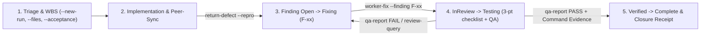

# Team Orchestration Director (ThinkTank v4.0)

**Modular Case Ledger multi-agent runtime, SQLite WAL single-source-of-truth backend, and 4-board Hallmark Studio sidecar UI for Antigravity.**

ThinkTank v4.0 replaces unverified agent chatter and multi-file state drift with a deterministic **Case Ledger** powered by modular FastAPI + SQLite WAL persistence, single-commit `CASE_EVENT` WebSocket synchronization, and keyed in-place ESM rendering. Every engineering or planning session runs under a canonical **7+1 role hierarchy**, **single-owner WBS file locks**, **HTTP 409 state-machine gates**, **real child-subagent session routing**, **evidence-required QA verification**, and **isolated per-run archival (`--new-run`)** inside a responsive bilingual (**English LTR / Persian RTL**) sidecar pane.

---

## Core Architecture



### What ThinkTank v4.0 Enforces

- **Single-Source-of-Truth SQLite WAL (`backend/store.py`):** All conversations, ordered replay events, `subagent_links`, and `workspace_sessions` live atomically inside `think_tank_sync.sqlite3` with automatic legacy migration and bloat pruning (`prune_bloat`), eliminating monolithic JSON file rewrites.
- **Single-Commit `CASE_EVENT` & `TRANSIENT_PULSE` Sync (`backend/ws_hub.py`):** Each domain mutation executes one SQLite commit and emits one `CASE_EVENT` with `changedSlices` (`seq` +1). Ephemeral tool telemetry and host focus shifts emit `TRANSIENT_PULSE` (`seq` +0) without invalidating board graphs. On WebSocket connect, the hub sends strictly `SYNC_REPLAY` or `SYNC_SNAPSHOT` (eliminating `SYNC_READY` duplicate HTTP fetches).
- **Multi-Run Isolation (`--new-run`):** Starting a new task or triage after a closed run archives prior work cleanly (`convId--run-1`, `convId--run-2`) with zero cross-run bleed.
- **Real Subagent Discovery & Hysteretic Workspace Binding (`backend/session_resolver.py`):** Maps child subagent UUIDs back to canonical parent conversations and roles without letting `post-tool-use` callbacks or unrelated workspaces hijack active ThinkTank sessions.
- **First-Class Finding Lifecycle & Evidence-Gated QA (`backend/ledger_domain.py`):** Enforces `Open -> Fixing -> InReview -> Testing -> Verified -> Closed` (plus `WontFix` with reason), max 7 findings per round, non-empty `--repro`, and `QA_REPORT PASS` proof (`evidenceCommand` + `exitCode == 0` + `runnerReason` for `host-fallback`).
- **Complete Interaction Graph:** Records directed edges for all collaborations, council proposal votes (`VOTE` / `DECISION`), channel messages (even without `@mention`), and `invoke_subagent` / `send_message` hook calls.

---

## Canonical 7+1 Team & Geometric Taxonomy

Role badges use geometric SVG monograms (`shape = authority tier`) with zero Unicode emojis:

| Tier | Frame | Monogram | Role ID | Responsibility & Gate Authority |
| :--- | :--- | :--- | :--- | :--- |
| Coordinator | Hexagon | `MA` | `main_agent` | Initial scope triage (`thinktank` vs `solo`), user escalation, final handoff |
| Supervisor | Square | `TM` | `team-manager` | WBS decomposition (`--files`, `--acceptance`), progress interrogation |
| Supervisor | Square | `CC` | `council-critic` | Red-team audit under fixed Severity Rubric, diff-scoped findings with `--repro` |
| Supervisor | Square | `CR` | `code-reviewer` | 3-point finding checklist (root cause, callers/tests, minimal diff); commands QA |
| Subordinate QA | Diamond | `QA` | `qa-reviewer` | Executes tests under `code-reviewer`; logs command, exit code, runner & output |
| Worker | Circle | `UI` | `ui-frontend-designer` | Case Ledger UI/UX, Hallmark tokens, WCAG AA contrast, zero AI slop |
| Worker | Circle | `BE` | `backend-auditor` | FastAPI state machine, SQLite WAL store, WebSocket hub, 409 gates & security |
| Worker | Circle | `SE` | `ecommerce_seo_operator` | Technical SEO, JSON-LD structured data, high-CTR e-commerce copy |
| Worker | Circle | `WP` | `wp_technical_operator` | WordPress & WooCommerce SRE, database/Redis tuning, catalog integrity |

---

## Sidecar UI Architecture (`sidecars/think-tank/`)

The sidecar is built with pure Native ESM modules (`.mjs`), slice-level revisions (`store.mjs`), `requestAnimationFrame`-batched gapless sync (`sync.mjs`), keyed in-place DOM/SVG patching (`dom.mjs`), and Hallmark v2.0 App Screen CSS (`tokens.css` + `app.css`):

1. **Command & WBS (`command-board.mjs`):** Live execution pulse strip, User Decision & Proposal gate, Severity-ranked Findings Matrix, WBS & Single-Owner File Locks table, and read-only Closure Receipt.
2. **Topology & Flow (`topology-board.mjs`):** 3-tier port-slotted SVG architecture graph with cubic S-curves, same-tier bus channels, collision-free edge badges, node neighborhood highlighting, and Timeline Scrubber (`Space` / `Arrow` / `L`).
3. **Sequence & Chronicle (`chronicle-board.mjs`):** Sticky swimlane sequence matrix + filterable Chronicle Feed + user-only Steering Composer.
4. **Squad & Telemetry (`squad-board.mjs`):** Canonical 7+1 roster with `verifiedSubagent` status, turn-cap consumption, active file locks, and live host tool telemetry.
5. **Contextual Dossier Drawer (`inspector.mjs`) & Settings Sheet:** Auto-collapses when idle so 100% of pane width stays available for the active board.

---

## Installation & Quickstart

### Prerequisites

- **Python 3.10+** (`fastapi`, `uvicorn`, `pydantic`, `httpx` listed in `backend/requirements.txt`)
- **Node.js 18+** (built-in modules only — zero external npm dependencies)
- **Antigravity** (defaults to `~/.gemini/config`, overrideable via `GEMINI_CONFIG_DIR` or `--target-dir`)

### Setup & Slash Command

```bash
python3 -m venv .venv
.venv/bin/pip install -r backend/requirements.txt
.venv/bin/python tools/install_plugin.py --check
.venv/bin/python tools/install_plugin.py --install --start-backend
```

Trigger an isolated Case Ledger run inside any Antigravity conversation:

```text
/ThinkTank <task description or architectural objective>
```

---

## Verification Suite & Bridge Diagnostics

```bash
# 1. Release parity, canonical roster, leak/emoji scan, py_compile, unittest & ESM tests
python tools/verify_release.py

# 2. Backend unit & integration suite directly
python -m unittest discover -s backend -p "test_*.py" -v

# 3. Sidecar ESM tests
npm test

# 4. Bridge status, runtime diagnostics, and SQLite compaction
python tools/thinktank_bridge.py status --conv-id <CONV_ID>
python tools/thinktank_bridge.py doctor
python tools/thinktank_bridge.py prune-db
```

---

## Repository Structure

```text
team-orchestration-director/
├── agents/                 # Canonical 8 subagent profiles (3 supervisors, 1 QA, 4 workers)
├── assets/                 # Plugin mark (logo.svg)
├── backend/                # Modular FastAPI server, store.py, ledger_domain.py, ws_hub.py, session_resolver.py, tests
├── commands/               # Antigravity /ThinkTank slash command definition
├── rules/                  # Team orchestration, parent authority & non-conflicting execution rules
├── sidecars/think-tank/    # Hallmark Studio 4-board ESM sidecar UI, tokens, i18n & ESM tests
├── skills/                 # 12 orchestration, critique, quality-gate, evidence & launcher skills
├── tools/                  # Bridge CLI, atomic hook runtime, installer & release verifier
├── CHANGELOG.md
├── CONTRIBUTING.md
├── LICENSE
├── package.json
└── plugin.json
```

---

## License

Released under the **MIT License** — see [LICENSE](LICENSE). Contribution guidelines are documented in [CONTRIBUTING.md](CONTRIBUTING.md), and release history is tracked in [CHANGELOG.md](CHANGELOG.md).
